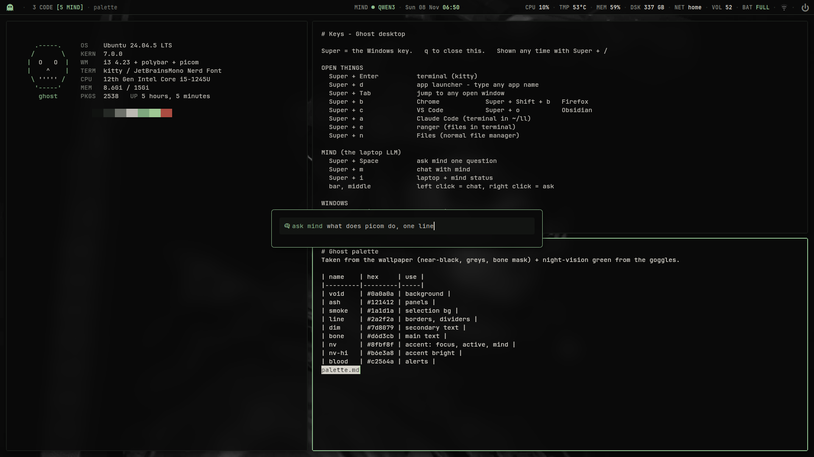

# ghost

My i3 setup on Ubuntu 24.04. Black and grey with one green accent, borrowed from a night-vision scope. Keyboard first, nothing on screen that doesn't earn its place.



## What's in it

| Part | Tool |
|---|---|
| Window manager | i3 4.23 (gaps, 2 px green border on the focused window) |
| Bar | polybar, styled like a HUD readout |
| Terminal | kitty, 82% opacity |
| Compositor | picom v12 (built from source, v10 as fallback): blur, shadows, rounded corners, windows pop in and fade out, glass level on Super + Ctrl + = / - |
| Launcher, window switcher, power menu | rofi |
| Notifications | dunst: app icons, a colour per app, 4 at a time, Super + ` brings the last one back, do not disturb on Super + Ctrl + ` |
| Lock screen | i3lock-color (falls back to i3lock): clock and a big ring centred on the main screen, green as you type, red when wrong, shows EN / Arabic so the password goes in the right layout |
| Face unlock | Howdy on the lock screen, monitor camera when docked, laptop IR when not. See [face/](face/README.md) |
| Tiling | autotiling: a new window splits the longer side, no thin slivers |
| hog | `bin/hog`: what is eating the laptop, by memory and live CPU. Pick an app to close, kill or restart it. `hog-watch` warns when memory runs low |
| Bar extras | mic and bluetooth menus, keyboard layout, everything clickable |
| Two screens | `bin/screen-watch` re-lays the screens when the monitor is plugged in or out |
| System card | `bin/ghostfetch` |
| Font | JetBrainsMono Nerd Font |

Colours are in [palette.md](palette.md). Every key is in [KEYS.md](KEYS.md), and `Super + /` shows the same file on screen, so the docs and the keys can't drift apart.

## The bar

Left: ghost icon (click for apps), workspaces, window title.
Middle: `MIND` status and the clock.
Right: `CPU TMP MEM DSK NET VOL BAT`, tray, power.

Labels are dim, values are bright, anything active is green and anything wrong is red. Click VOL to pick the sound output, right click to mute.

## Mind

The middle of the bar watches a local LLM running on another machine on my network (Ollama). It shows `MIND ○ IDLE`, `MIND ● QWEN3` when a model is loaded, or `MIND OFF`.

`Super + Space` opens a prompt and streams the answer into a floating terminal. `Super + m` opens a chat.

To point it at your own Ollama box:

```sh
mkdir -p ~/.config/mind
echo 192.168.1.50 > ~/.config/mind/host
```

The prompt and chat call a small `mind` CLI of mine that isn't in this repo. Without it the bar module still works, the two keys just do nothing.

## Install

```sh
sudo apt install i3 polybar picom kitty rofi dunst feh i3lock xss-lock policykit-1-gnome ranger imagemagick python3-pil jq curl
git clone https://github.com/redaloyalty/ghost ~/dotfiles
~/dotfiles/install.sh
```

Then log out, pick **i3** from the gear on the login screen and log in. The key sheet opens on first login.

`install.sh` links each folder into `~/.config`. Anything already there gets moved to `<name>.bak-<date>` first, so nothing is lost.

## Things you'll want to change

- **Wallpaper.** Not included, the one in my screenshot isn't mine to share. Put yours at `wallpaper/wall.png`, then run `bin/make-lock` to build the lock screen from it.
- **Screens.** `bin/screens` and the workspace lines in `i3/config` use my output names (`DP-2` external on the left, `eDP-1` laptop on the right). Run `xrandr` to see yours.
- **Battery and temperature.** `polybar/config.ini` uses `BAT0`, `AC` and thermal zone 10. Check `/sys/class/power_supply` and `/sys/class/thermal/*/type`.
- **Apps on keys.** Chrome, VS Code, Obsidian and Claude Code are bound in `i3/config` under "open things".

## Keys worth knowing first

```
Super + Enter        terminal
Super + d            launch anything
Super + /            all keys
Super + 1..0         workspaces (1-5 big screen, 6-0 laptop)
Ctrl + Alt + arrows  jump between screens
Super + Shift + s    screenshot a region, copied to the clipboard
Super + Shift + e    lock / log out / suspend / restart / shut down
```

If you get lost: `Super + Shift + e`, log out, pick your normal desktop at the gear. Nothing outside `~/.config` is touched.

## Notes from building it

- Two `exec_always` commands on one line joined with `;` don't work: i3 treats `;` as its own separator. Use one `sh -c '...'`.
- Under X11 the screens came up in the opposite order from GNOME, so the mouse went the wrong way. `bin/screens` fixes it with xrandr on every start.
- On Ubuntu the X session points `SSH_AUTH_SOCK` at gpg-agent, not the GNOME keyring that GNOME uses. If ssh suddenly asks for your key passphrase in i3, export `SSH_AUTH_SOCK=/run/user/$UID/gcr/ssh` in your shell rc.
- There's no `xclip` by default, so `bin/clip-image` puts screenshots on the clipboard through GTK instead.

## License

MIT
